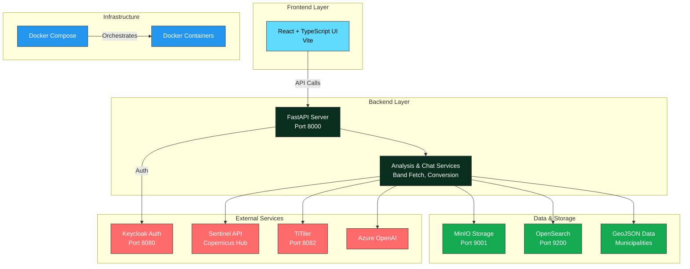

# 🌲 Forest Vitality

[](https://github.com/AmineChr54/ForestVitality/actions/workflows/ci.yml)

A satellite-based forest health monitoring platform for Germany. It pulls Sentinel-2 imagery from the Copernicus Data Space, computes vegetation indices (NDVI, NDWI, EVI, NDMI) for any municipality or hand-drawn region, renders them as map overlays, and lets users explore the results with an AI assistant. Full-stack: FastAPI backend, React + TypeScript frontend, Keycloak RBAC, and a Docker Compose infrastructure.

---

## 📋 Table of Contents

- [Overview](#overview)
- [System Architecture](#system-architecture)
- [Tech Stack](#tech-stack)
- [Prerequisites](#prerequisites)
- [Installation Guide](#installation-guide)
- [Development Environment Setup](#development-environment-setup)
- [Running the Application](#running-the-application)
- [Available Services](#available-services)
- [Authentication](#authentication)
- [Running Tests](#running-tests)

---

## 🎯 Overview

**Forest Vitality** gives forest managers and analysts:

- **Vegetation-index maps** for any German municipality (Bundesland → Bezirk → Kreis hierarchy) or a hand-drawn polygon
- **Split-view comparison** of two dates for the same region
- **On-demand ingestion** of Sentinel-2 L2A scenes from Copernicus, streamed to the UI with live progress (Server-Sent Events)
- **Region statistics** (mean / min / max) computed on the fly from Cloud-Optimized GeoTIFFs
- **AI assistant** (LangChain agent on Azure OpenAI) that can search scenes, look up municipalities and compute indices through role-gated tools
- **Role-based access control** with Keycloak (admin, forest analyst, data manager, viewer)

### Key Features

🛰️ Sentinel-2 band download, resampling and stacking into COGs (Rasterio)  
🗺️ Raster tiles via TiTiler band-math expressions, clipped client-side to the region  
🤖 LangChain tool-calling agent with geo-context from the current map view  
🔐 Keycloak OIDC login, permission mapping and audit logging  
💾 MinIO (S3) storage for scene COGs, OpenSearch for scene metadata and logs  
✅ Backend and frontend test suites, run in GitHub Actions on every push  

---

## 🏗️ System Architecture



---

## 🛠️ Tech Stack

### Backend
- **Framework**: FastAPI (Python 3.11), served by Gunicorn with Uvicorn workers
- **Raster processing**: Rasterio / GDAL, NumPy
- **Metadata & logs**: OpenSearch
- **Storage**: MinIO (S3-compatible, via boto3)
- **Auth**: Keycloak JWT validation (JWKS), permission mapping, audit logging
- **AI**: LangChain + Azure OpenAI
- **External APIs**: Copernicus Data Space (STAC search + OAuth), TiTiler
- **Tests**: pytest, pytest-cov

### Frontend
- **Framework**: React 18 + TypeScript, Vite
- **Mapping**: Leaflet with a custom canvas layer for clipped TiTiler tiles
- **State**: Zustand
- **HTTP**: Axios (auth + error interceptors), fetch-based SSE client
- **Auth**: Keycloak OIDC authorization-code flow
- **Tests**: Vitest, ESLint (typescript-eslint, React Hooks rules)

### Infrastructure
- **Containers**: Docker, Docker Compose (OpenSearch, Keycloak + PostgreSQL, MinIO, TiTiler)
- **CI**: GitHub Actions
- **Task runner**: [Task](https://taskfile.dev) (`Taskfile.yml`)

---

## 📦 Prerequisites

Before starting, ensure you have the following installed:

### Required
- **Docker Desktop** - [Download](https://www.docker.com/products/docker-desktop)
- **Node.js** 20.19+ or 22+ - [Download](https://nodejs.org/)
- **Python** 3.11+ - [Download](https://www.python.org/)
- **Git** - [Download](https://git-scm.com/)

### Recommended
- **VS Code** with Python & React extensions

### System Requirements
- **Disk Space**: At least 20 GB for Docker images and data
- **RAM**: Minimum 8 GB (16 GB recommended)
- **Docker Desktop Settings**: 
  - CPUs: 4+
  - Memory: 8 GB+
  - Disk: 50 GB+

---

## 🚀 Installation Guide

### Step 1: Clone the Repository

```bash
git clone https://github.com/AmineChr54/ForestVitality.git
cd ForestVitality
```

### Step 2: Set Up Environment Variables

Copy the templates and fill in your own credentials:

```bash
cp backend/.env.example backend/.env                 # Copernicus + Azure OpenAI credentials
cp frontend/.env.local.example frontend/.env.local
cp infra/.env.example infra/.env                      # optional: override default dev passwords
```

You need a free [Copernicus Data Space](https://dataspace.copernicus.eu/) account for satellite data and an Azure OpenAI deployment for the AI assistant.

### Step 3: Install Backend Dependencies

```bash
cd backend
python -m venv .venv
# On Windows:
.\.venv\Scripts\Activate.ps1
# On macOS/Linux:
# source .venv/bin/activate

pip install -r requirements.txt
```

### Step 4: Install Frontend Dependencies

```bash
cd ../frontend
npm install
```

### Step 5: Start Docker Services

Go back to the project root:

```bash
cd ..
```

Ensure Docker Desktop is running, then start all services:

```bash
docker-compose -f infra/docker-compose.yml up -d
```

This will start:
- OpenSearch (port 9200)
- MinIO (API 9000, console 9001)
- Keycloak (port 8080) with the `geo-platform` realm and dev users imported automatically
- PostgreSQL for Keycloak (port 5432)
- TiTiler (port 8082)

### Step 6: Verify Installation

Check that all containers are running:

```bash
docker ps
```

You should see 5 running containers. Wait 30-60 seconds for services to be fully initialized.

---

## 💻 Development Environment Setup

### Using Task Runner (Recommended)

If [Task](https://taskfile.dev) is installed, starting the entire development environment is simple (the Task targets use PowerShell, so this path is Windows-only; use the manual setup below on macOS/Linux):

```bash
# Start all services (Docker + Backend + Frontend)
task dev

# Later, stop services with:
task stop
```

### Manual Setup

If you prefer to start services individually:

```bash
# Terminal 1: Start Docker containers
docker-compose -f infra/docker-compose.yml up -d

# Terminal 2: Start Backend
cd backend
.\.venv\Scripts\Activate.ps1  # Windows
# source .venv/bin/activate  # macOS/Linux
uvicorn backend_app.main:app --reload --host 0.0.0.0 --port 8000

# Terminal 3: Start Frontend
cd frontend
npm run dev
```

---

## 🎮 Running the Application

Once everything is set up, access the services via:

| Service              | URL                            | Credentials (dev only)           |
|----------------------|--------------------------------|----------------------------------|
| **Frontend**         | http://localhost:5173          | see [Authentication](#authentication) |
| **Backend API Docs** | http://localhost:8000/docs     | (Open access)                    |
| **Keycloak Admin**   | http://localhost:8080/admin    | `admin` / `admin`                |
| **MinIO Console**    | http://localhost:9001          | `admin` / `admin123`             |
| **TiTiler Docs**     | http://localhost:8082/api.html | (Open access)                    |
| **OpenSearch**       | http://localhost:9200          | (Use DBeaver)                    |

---

## 🔐 Authentication

Login uses Keycloak's OIDC authorization-code flow. The backend validates JWTs against Keycloak's JWKS endpoint and maps realm roles to fine-grained permissions (e.g. `analysis:run`, `data:ingest`).

### Development users

The Keycloak realm import (`infra/keycloak/import/realm-export.json`) creates these users:

| Username         | Password    | Role             | Can                                       |
|------------------|-------------|------------------|-------------------------------------------|
| `adminuser`      | `admin123`  | `administrator`  | Everything                                |
| `forestanalyzer` | `forest123` | `forest_analyst` | Run analyses, read scenes and regions     |
| `datauser`       | `data123`   | `data_manager`   | Ingest and delete data, read scenes       |
| `viewuser`       | `view123`   | `viewer`         | Read-only                                 |

> ⚠️ All credentials in this repository (users above, `admin/admin` for the Keycloak console, `admin/admin123` for MinIO) are **local-development defaults only**. Override them via `infra/.env` for any shared or deployed environment. See [docs/USER_MANAGEMENT.md](docs/USER_MANAGEMENT.md) and [docs/RBAC_IMPLEMENTATION.md](docs/RBAC_IMPLEMENTATION.md).

---

## ✅ Running Tests

```bash
# Backend (pytest, ~35 tests incl. RBAC mapping and controller tests with mocked services)
cd backend && pytest tests/ --cov=backend_app

# Frontend (Vitest, ~100 tests for API clients, geo and role utilities) + lint + build
cd frontend && npm run lint && npm test && npm run build
```

Or `task test` to run both. The same checks run in [GitHub Actions](.github/workflows/ci.yml) on every push. See [docs/TESTING.md](docs/TESTING.md) for the full test matrix.

---

## 📚 Available Services

### Backend API Endpoints

- **Ingestion**: `POST /ingest/stream` - Download and stack Sentinel-2 scenes, streaming progress (SSE)
- **Analysis**: `POST /analysis/` - Vegetation-index analysis as a background job
- **Municipality**: `GET /municipality/regions`, `/regions/geometry`, `/lookup` - Region hierarchy and boundaries
- **Sentinel**: `GET /sentinel/fetch` - Scene search in the Copernicus STAC catalogue
- **Chat**: `POST /chat` - LangChain AI agent
- **Logs**: `POST /save-log`, `GET /logs/{id}` - Analysis logs in OpenSearch

Overview with permissions: [docs/api.md](docs/api.md). Interactive docs: http://localhost:8000/docs

### Database & Services

- **OpenSearch**: Scene metadata and logs (http://localhost:9200)
- **MinIO**: S3-compatible object storage (http://localhost:9001)
- **TiTiler**: Tile server for satellite imagery (http://localhost:8082)
- **Keycloak**: Identity & Access Management (http://localhost:8080)

---

## 📖 Additional Documentation

For detailed information, see:
- [API Overview](docs/api.md)
- [Testing Strategy](docs/TESTING.md)
- [Frontend README](frontend/README.md)
- [Deployment Guide](docs/DEPLOYMENT.md)
- [Security Audit](docs/SECURITY_AUDIT.md)
- [RBAC Implementation](docs/RBAC_IMPLEMENTATION.md)
- [TiTiler Integration](docs/TITILER_INTEGRATION.md)
