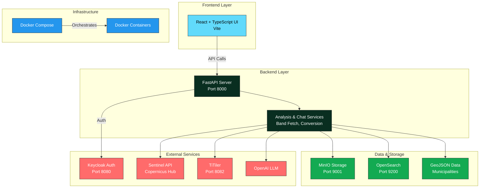

# 🌲 Forest Vitality

A comprehensive satellite-based forest health monitoring platform that leverages Sentinel satellite imagery and advanced vegetation indices to provide real-time analysis of forest vitality. Built with a modern full-stack architecture featuring Python FastAPI backend, React TypeScript frontend, and containerized microservices.

---

## 📋 Table of Contents

- [Overview](#overview)
- [System Architecture](#system-architecture)
- [Tech Stack](#tech-stack)
- [Prerequisites](#prerequisites)
- [Installation Guide](#installation-guide)
- [Development Environment Setup](#development-environment-setup)
- [Running the Application](#running-the-application)
- [Available Services](#available-services)
- [Authentication](#authentication)

---

## 🎯 Overview

**Forest Vitality** provides environmental professionals, researchers, and forest managers with:

- **Real-time forest health monitoring** using satellite-derived vegetation indices (NDVI, etc.)
- **Interactive geospatial mapping** with municipality-level analysis
- **Data ingestion** from Copernicus Sentinel satellites
- **REST APIs** for programmatic access to analysis results
- **Secure authentication** via Keycloak
- **AI-powered chat agent** for intelligent data insights
- **Search and retrieval** of historical satellite data

### Key Features

✨ Sentinel satellite data integration  
🗺️ Interactive maps with vector tiles (TiTiler)  
🤖 AI-powered analysis agent with LangChain  
🔐 Role-Based Access Control (RBAC)  
📊 Advanced vegetation index calculations  
💾 MinIO cloud storage integration  
🔍 Full-text search with OpenSearch  

---

## 🏗️ System Architecture



---

## 🛠️ Tech Stack

### Backend
- **Framework**: FastAPI (Python)
- **Server**: Uvicorn with Gunicorn
- **Data Processing**: Rasterio, GDAL
- **Search**: OpenSearch
- **Storage**: MinIO (S3-compatible)
- **Authentication**: Keycloak, JWT
- **AI/ML**: LangChain, OpenAI
- **APIs**: Copernicus Hub, TiTiler

### Frontend
- **Framework**: React with TypeScript
- **Build Tool**: Vite
- **Styling**: CSS
- **State Management**: Redux/Context
- **HTTP Client**: Axios
- **Mapping**: Leaflet/Mapbox

### Infrastructure
- **Containerization**: Docker
- **Orchestration**: Docker Compose
- **Task Runner**: Task (Taskfile.yml)
- **Package Management**: pip, npm

---

## 📦 Prerequisites

Before starting, ensure you have the following installed:

### Required
- **Docker Desktop** - [Download](https://www.docker.com/products/docker-desktop)
- **Node.js** (v16 or higher) - [Download](https://nodejs.org/)
- **Python** (v3.9 or higher) - [Download](https://www.python.org/)
- **Git** - [Download](https://git-scm.com/)

### Recommended
- **VS Code** with Python & React extensions

### System Requirements
- **Disk Space**: At least 20 GB for Docker images and data
- **RAM**: Minimum 8 GB (16 GB recommended)
- **Docker Desktop Settings**: 
  - CPUs: 4+
  - Memory: 8 GB+
  - Disk: 50 GB+

---

## 🚀 Installation Guide

### Step 1: Clone the Repository

```bash
git clone https://github.com/AmineChr54/ForestVitality.git
cd ForestVitality
```

### Step 2: Set Up Environment Variables

Configure `.env` files for backend and frontend using the provided `.env` variables.

### Step 3: Install Backend Dependencies

```bash
cd backend
python -m venv .venv
# On Windows:
.\.venv\Scripts\Activate.ps1
# On macOS/Linux:
# source .venv/bin/activate

pip install -r requirements.txt
```

### Step 4: Install Frontend Dependencies

```bash
cd ../frontend
npm install
```

### Step 5: Start Docker Services

Go back to the project root:

```bash
cd ..
```

Ensure Docker Desktop is running, then start all services:

```bash
docker-compose -f infra/docker-compose.yml up -d
```

This will start:
- OpenSearch (Port 9200)
- MinIO (Port 9001)
- Keycloak (Port 8080)
- TiTiler (Port 8082)
- PostgreSQL (Port 5432)

### Step 6: Verify Installation

Check that all containers are running:

```bash
docker ps
```

You should see 5-6 running containers. Wait 30-60 seconds for services to be fully initialized.

---

## 💻 Development Environment Setup

### Using Task Runner (Recommended)

If Task is installed, starting the entire development environment is simple:

```bash
# Start all services (Docker + Backend + Frontend)
task dev

# Later, stop services with:
task stop
```

### Manual Setup

If you prefer to start services individually:

```bash
# Terminal 1: Start Docker containers
docker-compose -f infra/docker-compose.yml up -d

# Terminal 2: Start Backend
cd backend
.\.venv\Scripts\Activate.ps1  # Windows
# source .venv/bin/activate  # macOS/Linux
uvicorn backend_app.main:app --reload --host 0.0.0.0 --port 8000

# Terminal 3: Start Frontend
cd frontend
npm run dev
```

---

## 🎮 Running the Application

Once everything is set up, access the services via:

| Service              | URL                            | Credentials                      |
|----------------------|--------------------------------|----------------------------------|
| **Frontend**         | http://localhost:5173          | `testuser` / `test123`          |
| **Backend API Docs** | http://localhost:8000/docs     | (Open access)                    |
| **Keycloak Admin**   | http://localhost:8080/admin    | `admin` / `admin`                |
| **MinIO Console**    | http://localhost:9001          | `admin` / `admin123`             |
| **TiTiler Docs**     | http://localhost:8082/api.html | (Open access)                    |
| **OpenSearch**       | http://localhost:9200          | (Use DBeaver)                    |

---

## 🔐 Authentication

### Default Test Users

The application comes with pre-configured test users:

| Username   | Password   | Role            | Permissions                          |
|------------|-----------|-----------------|--------------------------------------|
| `admin`    | `admin`   | `SYSTEM_ADMIN`  | Full system access                   |
| `testuser` | `test123` | `ANALYST`       | Read/analyze satellite data          |

> **Note**: In production, users are managed through Keycloak. Static users are currently used for development.

---

## 📚 Available Services

### Backend API Endpoints

- **Analysis**: `/api/v1/analysis` - Vegetation index calculations
- **Chat Agent**: `/api/v1/chat` - AI-powered forest insights
- **Sentinel Data**: `/api/v1/sentinel` - Satellite data retrieval
- **Ingestion**: `/api/v1/ingest` - Data import pipeline
- **Municipality**: `/api/v1/municipality` - Geographic boundaries
- **Index**: `/api/v1/index` - Data indexing operations

See full documentation at http://localhost:8000/docs

### Database & Services

- **OpenSearch**: Full-text search engine (http://localhost:9200)
- **MinIO**: S3-compatible object storage (http://localhost:9001)
- **TiTiler**: Tile server for satellite imagery (http://localhost:8082)
- **Keycloak**: Identity & Access Management (http://localhost:8080)

---

## 📖 Additional Documentation

For detailed information, see:
- [API Documentation](docs/api.md)
- [Deployment Guide](docs/DEPLOYMENT.md)
- [Security Audit](docs/SECURITY_AUDIT.md)
- [RBAC Implementation](docs/RBAC_IMPLEMENTATION.md)
- [TiTiler Integration](docs/TITILER_INTEGRATION.md)
